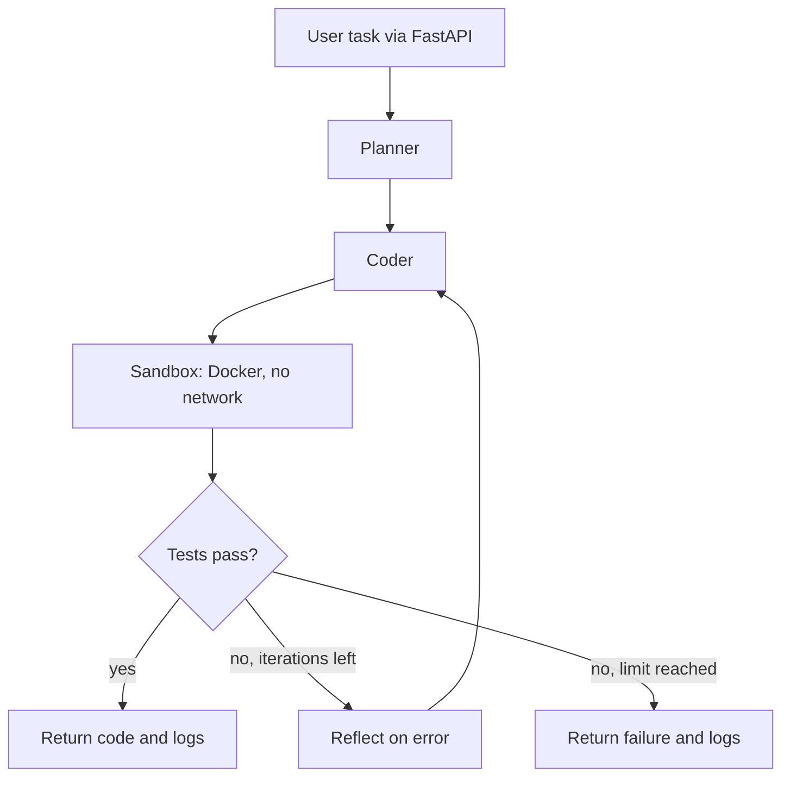

# Autonomous Coding Agent With Sandbox

> Work in progress. Sections marked TODO are filled in as the project is built.

## 1. What we have built

TODO (written at the end, from what actually works).

**Planned scope:** give the agent a coding task in plain English. It writes Python code and tests, runs them in an isolated Docker sandbox, reads any errors, and fixes the code. It repeats until the tests pass or the iteration limit is reached. It is exposed through a FastAPI endpoint.

## 2. Architecture (planned)



## 3. Results

TODO. Numbers will come from real runs only.

## 4. Decisions

See [Decisions.md](Decisions.md) for every major choice and the alternatives we rejected.

## Setup

```bash
python -m venv .venv
source .venv/bin/activate        # Windows: .venv\Scripts\activate
pip install -r requirements.txt
cp .env.example .env             # then add your Groq API key
```

Docker must be installed and running (used for the sandbox).
